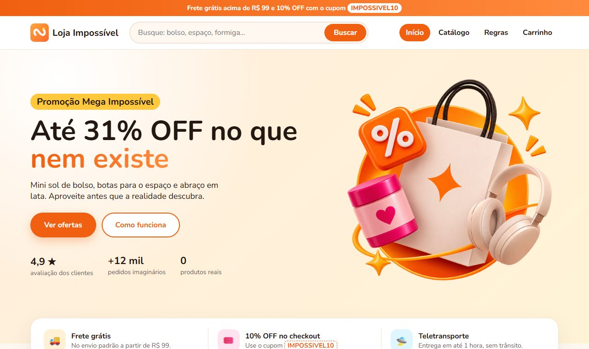
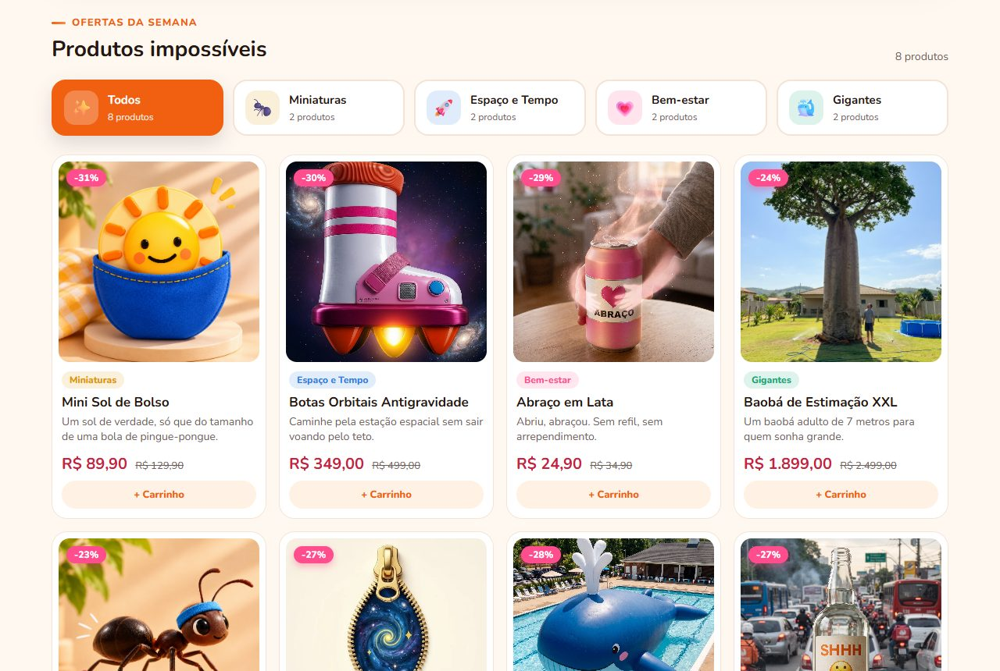
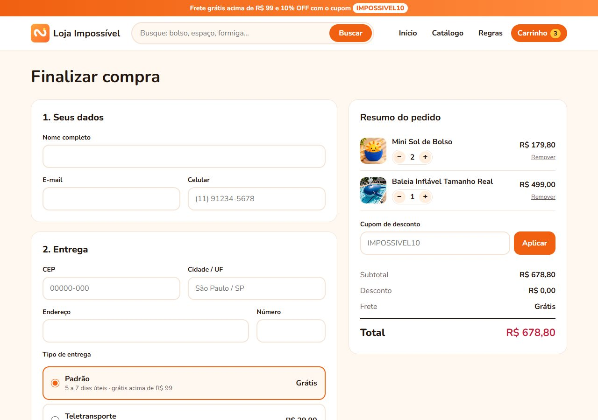

<h1 align="center">
  <br>
  Loja Impossível
</h1>

<p align="center">
  Uma loja online de <strong>produtos que não existem</strong>, feita do zero com HTML, CSS e JavaScript puros.
  <br>
  Projeto de estudo desenvolvido durante a formação no <strong>PROA</strong>.
</p>

<p align="center">
  <a href="https://viniciusaraujo-coder.github.io/Loja_Escola/"><strong>Ver a loja funcionando »</strong></a>
</p>

<p align="center">
  
  
  
  
</p>

<p align="center">
  
</p>

---

## Sobre o projeto

A Loja Impossível vende um mini sol de bolso, botas antigravidade, abraço em lata, um baobá de 7 metros e outras coisas que nunca vão existir. A ideia era ter um tema divertido para praticar, do começo ao fim, tudo o que uma loja virtual de verdade precisa: vitrine, busca, página de produto, carrinho, checkout com validação e tela de pedido confirmado.

Todo produto do catálogo segue pelo menos uma das **6 regras impossíveis**:

| | Regra | | Regra |
|:-:|---|:-:|---|
| 👖 | Cabe no bolso | 🐜 | Serve em uma formiga |
| ✈️ | Não cabe em avião | ⚡ | Começa com Z |
| 🚀 | Uso no espaço | 🎯 | Uso único |

> Projeto educacional: loja, produtos, preços e pagamentos são fictícios. Nenhuma compra é feita de verdade.

## Funcionalidades

**Vitrine**
- Catálogo montado pelo JavaScript a partir de uma lista de produtos
- Filtro por categoria com a quantidade de itens em cada uma
- Busca em tempo real, que ignora acentos ("baoba" encontra "Baobá")
- Selo de desconto calculado automaticamente em cada card

**Produto**
- Uma única página `produto.html` que mostra qualquer produto pelo endereço (`?id=`)
- Preço com % de desconto e parcelamento
- Sugestões de produtos parecidos

**Carrinho e checkout**
- Carrinho salvo no navegador (`localStorage`), que não se perde ao trocar de página
- Alterar quantidade e remover itens, com os totais recalculados na hora
- Cupom de desconto **`IMPOSSIVEL10`** (10% OFF)
- Frete grátis acima de R$ 99 ou entrega por teletransporte
- **Busca de endereço pelo CEP** usando a API do [ViaCEP](https://viacep.com.br)
- Validação de todos os campos e máscaras para CEP, celular e cartão
- Pagamento por Pix, cartão ou boleto

**Pedido confirmado**
- Resumo do pedido com número, entrega, itens e totais (`sessionStorage`)

**Responsivo**: funciona no computador, tablet e celular.

## Telas

<table>
  <tr>
    <td></td>
    <td></td>
  </tr>
  <tr>
    <td align="center">Catálogo com filtros</td>
    <td align="center">Página de produto</td>
  </tr>
  <tr>
    <td></td>
    <td align="center"></td>
  </tr>
  <tr>
    <td align="center">Checkout</td>
    <td align="center">Versão para celular</td>
  </tr>
</table>

## Teste você mesmo

1. Abra a [loja](https://viniciusaraujo-coder.github.io/Loja_Escola/) e adicione alguns produtos ao carrinho
2. No checkout, use o cupom **`IMPOSSIVEL10`**
3. Digite um CEP real (por exemplo `01001-000`) e veja o endereço ser preenchido sozinho
4. Para o cartão, qualquer número de 16 dígitos com validade futura funciona

## O que pratiquei neste projeto

**HTML**
- Tags semânticas (`header`, `nav`, `main`, `section`, `article`, `footer`) escolhidas pelo significado
- Formulários acessíveis: `label` ligado ao campo, `fieldset`/`legend`, `aria-current`, `aria-pressed`

**CSS**
- Layout com **Flexbox** e **Grid**
- Responsividade com **media queries** (960px, 720px e 480px)
- Variáveis CSS (`--cor`) para dar a cor de cada categoria
- `aspect-ratio` + `object-fit` para deixar todas as fotos quadradas sem distorcer
- Degradês, sombras, transições e efeitos de hover

**JavaScript**
- Manipulação do DOM e geração de HTML com template strings
- Eventos (`click`, `input`, `submit`) e delegação de eventos
- `localStorage` e `sessionStorage` para guardar dados entre páginas
- `URLSearchParams` para ler o produto e a busca pelo endereço
- `fetch` com `async/await` para consumir uma API externa (ViaCEP)
- Validação de formulário e formatação de valores em reais com `toLocaleString`

## Estrutura de pastas

```
Loja_Escola/
├── index.html            página inicial e catálogo
├── pages/
│   ├── produto.html      detalhes de um produto (?id=)
│   ├── checkout.html     carrinho, entrega e pagamento
│   └── sucesso.html      pedido confirmado
├── css/
│   └── styles.css        todos os estilos, separados por seção
├── js/
│   ├── produtos.js       lista de produtos e funções compartilhadas
│   ├── carrinho.js       carrinho no localStorage
│   ├── index.js          catálogo, filtros e busca
│   ├── produto.js        página de produto
│   ├── checkout.js       totais, cupom, frete, CEP e validação
│   └── sucesso.js        resumo do pedido
├── img/                  logo, destaque e fotos dos produtos
└── docs/                 capturas de tela deste README
```

## Como rodar no seu computador

Não precisa instalar nada.

```bash
git clone https://github.com/ViniciusAraujo-Coder/Loja_Escola.git
```

Depois é só abrir o arquivo `index.html` no navegador. Se usar o VS Code, a extensão **Live Server** também funciona.

## Autor

Feito por **Vinicius Araujo** · [GitHub](https://github.com/ViniciusAraujo-Coder)

Distribuído sob a licença MIT. Veja o arquivo [LICENSE](LICENSE).
